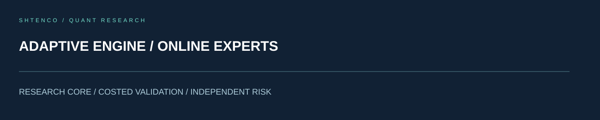
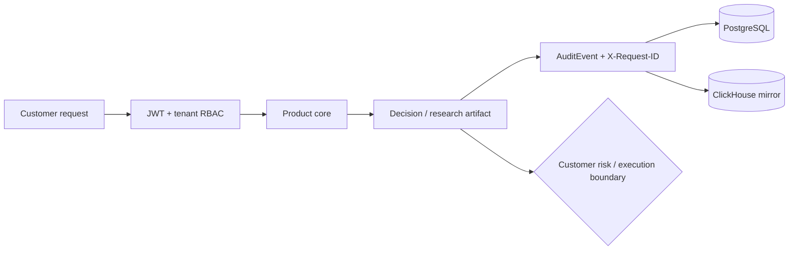
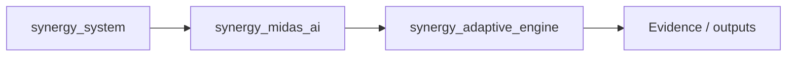
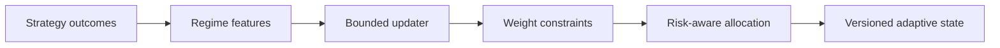

<!-- SCIENTIFIC-V4-2026:START -->


[Научное досье V4](docs/SCIENTIFIC_DOSSIER_V4_2026.md) — оригинальная модель, экспериментальная проверка, применение. Прежний README сохранён полностью.
<!-- SCIENTIFIC-V4-2026:END -->

# SYNERGY Adaptive Engine

> **Bounded online strategy weighting and regime-aware adaptation for systematic portfolios**

Version: `2.0.0`

**Enterprise v2.0.0** · Python 3.11+ · FastAPI/OpenAPI · Docker/Compose · PostgreSQL/ClickHouse audit · RBAC/JWT · automated tests

**Designed for:** Quant funds, prop firms, systematic portfolio teams and adaptive research desks  
**Primary endpoint:** `POST /enterprise/v1/adaptive/update`  
**Commercial mode:** paid technical pilot · source-code licensing · OEM/white-label integration

> [!IMPORTANT]
> This repository is trading/research infrastructure. It does **not** promise investment returns, profitable execution, regulatory approval or suitability for any specific fund. Production use requires customer OOS/paper/canary evidence plus Security, Risk, Ops and Compliance approval.

## What a fund gets
- deterministic product core separated from the enterprise boundary;
- tenant-aware JWT/RBAC roles: `viewer/researcher/trader/risk/operator/admin`;
- `X-Request-ID` correlation and auditable product actions;
- PostgreSQL authoritative audit store with optional ClickHouse analytical mirror;
- health and Prometheus-compatible metrics;
- Bybit V5, CCXT and MetaTrader 5 integration contracts with live execution disabled by default;
- retry/circuit-breaker controls, Docker/Compose reference deployment, demo data and load harnesses.

## Decision flow


## Quick evaluation
```bash
python -m venv .venv
source .venv/bin/activate
pip install -e '.[dev,enterprise]'
pytest -q
python -m synergy_adaptive_engine.api
```
Open `http://127.0.0.1:8000/docs`.

`/enterprise/v1/adaptive/update` is authorized for **researcher, risk**; administrators inherit privileged access.

## Verification snapshot
| Evidence | Current snapshot |
|---|---:|
| Unit/acceptance tests | **20 passed** |
| HTTP health smoke | **80/80 HTTP 200** |
| Local health p50 / p95 / p99 | **15.7 / 91.1 / 133.1 ms** |
| Local health throughput | **454 req/s** |

These HTTP figures are a local container smoke benchmark against `/enterprise/health` with 80 requests / concurrency 16. They are **not** a production SLA and do not measure DB, venue or market-execution latency.

## CTO evaluation path
1. [CTO due diligence](docs/CTO_DUE_DILIGENCE.md)
2. [Architecture diagrams](docs/ARCHITECTURE_DIAGRAMS.md)
3. [API examples](docs/API_EXAMPLES.md)
4. [Security policy](SECURITY.md)
5. [Benchmarks and acceptance](docs/BENCHMARKS_AND_ACCEPTANCE.md)
6. [Reference SLA/SLO](docs/SLA_SLO.md)
7. [Deployment checklist](docs/DEPLOYMENT_CHECKLIST.md)
8. [Customer pilot](docs/CUSTOMER_PILOT.md)

## Commercial boundary
“Enterprise-ready” means packaged for technical evaluation and controlled deployment. Customer production activation requires its own infrastructure, identity, security, operational, legal/compliance and trading-risk approvals.


<!-- SYNERGY-FEDERATION-PASSPORT:START -->
---

##  SYNERGY federation passport

**Домен:**  Adaptive regime engine  
**Архитектурный родитель:** [`synergy_midas_ai`](https://github.com/Shtenco/synergy_midas_ai)  
**Архитектурный корень:** [`synergy_system`](https://github.com/Shtenco/synergy_system)



Архитектурная стрелка — это карта федерации, а не автоматически подтверждённая runtime dependency.

### Единый стандарт

Каждый проект должен документировать реальную проблему, реализацию, тесты, evidence, ограничения, file map, воспроизводимость, roadmap и границы утверждений. Это тот же принцип, который используется в `dlp_solver`.

### Навигация

- [ Атлас всех 75 репозиториев](https://github.com/Shtenco/synergy_system/blob/main/docs/SYNERGY_REPOSITORY_ATLAS.md)
- [ Машиночитаемый registry](https://github.com/Shtenco/synergy_system/blob/main/registry/SYNERGY_REPOSITORIES.json)
- [ SYNERGY SYSTEM](https://github.com/Shtenco/synergy_system)

### Evidence rule

`GREEN` означает только воспроизводимо подтверждённый тезис. Гипотеза, benchmark без корректного протокола, архитектурная диаграмма или красивый экономический цикл сами по себе GREEN не дают.

<!-- SYNERGY-FEDERATION-PASSPORT:END -->
---

#  Глубокая техническая спецификация Adaptive Engine

##  Проблема

Онлайн-адаптация легко превращается в скрытое переобучение на шуме. Движок должен менять веса стратегий только внутри заранее определённых границ.

##  Pipeline



##  Входы

- strategy scores;
- recent outcomes;
- regime state;
- turnover/cost;
- policy bounds;
- current weights;

##  Выходы

- new bounded weights;
- adaptation reason;
- state version;
- confidence/uncertainty;
- rollback target;

##  Непереговорные инварианты

```text
weight bounds are hard
no hidden strategy creation
adaptation cannot bypass RiskGuard
state updates are versioned/idempotent
rollback path required
```

##  Как ловить ложный GREEN

- health/API throughput не использовать как доказательство market edge;
- обязательны timestamp/state-version checks;
- adversarial/negative fixtures должны проверять отказ;
- сохранять полный request → decision → execution/evidence trace;
- live claims отделять от local smoke и simulation;
- cost/latency/failure assumptions должны быть явными.

##  Контракт с соседями

- [`synergy_midas_ai`](https://github.com/Shtenco/synergy_midas_ai)
- [`synergy_quantlab`](https://github.com/Shtenco/synergy_quantlab)
- [`synergy_riskguard`](https://github.com/Shtenco/synergy_riskguard)
- [`synergy_ai_investment_committee`](https://github.com/Shtenco/synergy_ai_investment_committee)

##  Следующий доказательный рубеж

1. frozen acceptance fixtures;
2. negative/adversarial suite;
3. typed cross-repo schema;
4. end-to-end trace ID;
5. rollback/recovery evidence;
6. documented failure-mode table;
7. reproducible evidence bundle.
