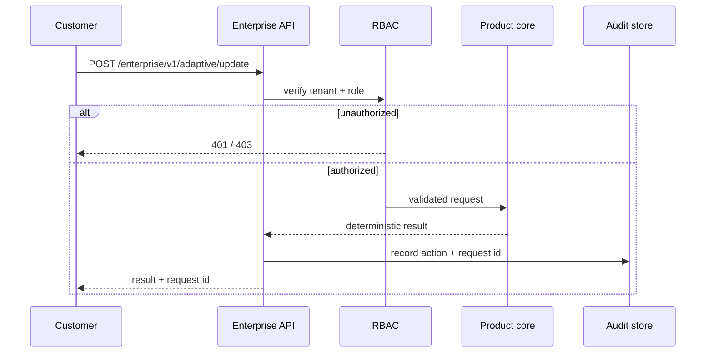

# Architecture diagrams — SYNERGY Adaptive Engine

## Enterprise boundary
```mermaid
flowchart TB
  Client[Fund / desk client] --> Gateway[Customer gateway\nOIDC / mTLS / rate limits]
  Gateway --> API[FastAPI enterprise boundary]
  API --> Auth[JWT principal + tenant RBAC]
  Auth --> Core[Product core]
  Core --> Result[Decision / research artifact]
  Result --> Audit[AuditEvent + X-Request-ID]
  Audit --> PG[(PostgreSQL)]
  Audit --> CH[(ClickHouse)]
  API --> Metrics[/enterprise/metrics]
  API --> Health[/enterprise/health]
```

## Request sequence


Failure policy: authentication failures deny; live gate disabled means no live dispatch; retry/circuit-breaker is bounded; unknown financial side effects are never blindly replayed.
